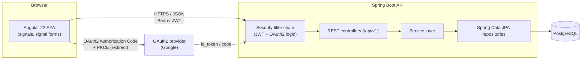
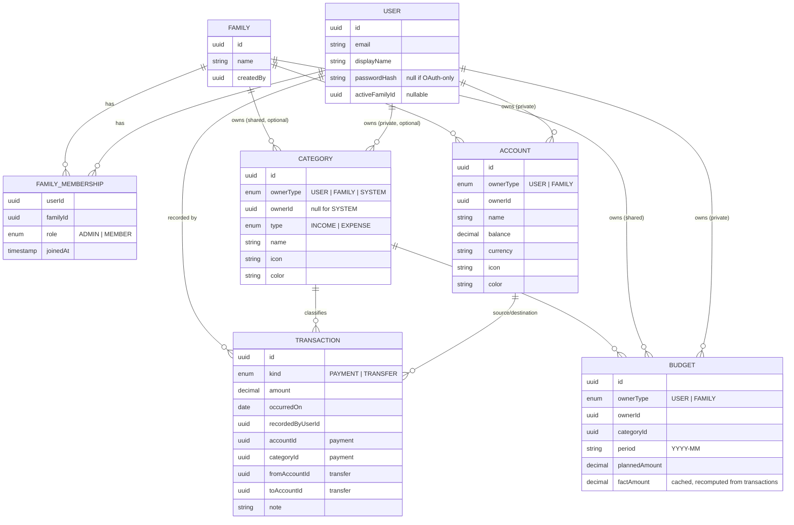
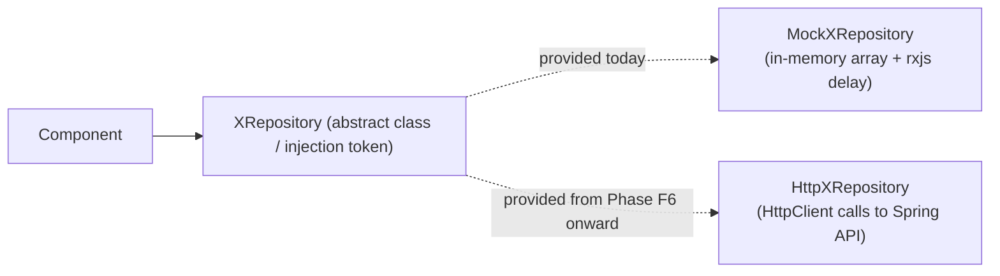
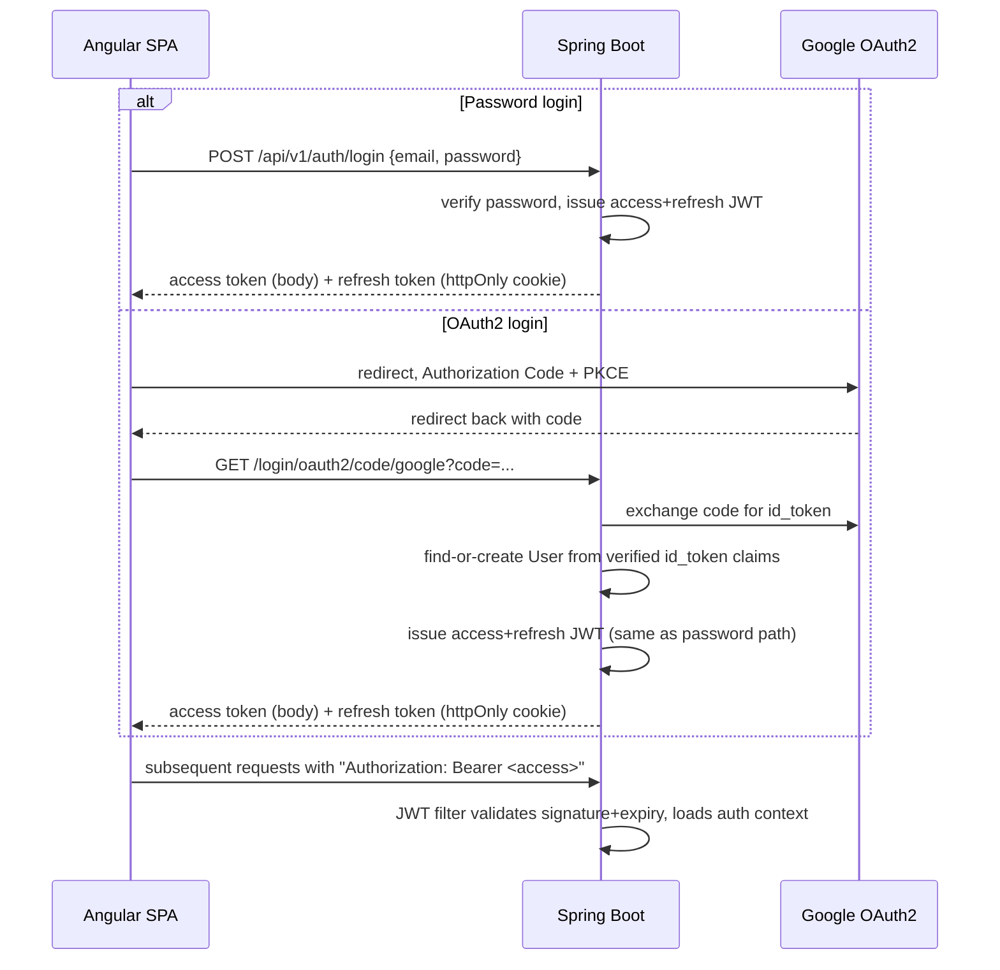

# Family Budget — Architecture

Status: draft v0.1 · 2026-10-05
Companion doc: [PLAN.md](./PLAN.md) (roadmap, phases, open decisions)

## 1. Purpose

Family Budget lets a household track money together while each member keeps some of it
private. A user can:

- manage **private** accounts, categories, transactions and budgets visible only to them,
- manage **shared** (family-wide) accounts, categories, transactions and budgets visible to
  every member of their family,
- belong to exactly one family at a time (v1 simplification, see §7).

This document describes the target system shape. It is intentionally stack-accurate but
implementation-light — concrete code arrives phase by phase per [PLAN.md](./PLAN.md).

## 2. High-level system



- **Frontend** is a single Angular SPA. No server-side rendering requirement for v1.
- **Backend** is a single Spring Boot modular-monolith (not microservices — scope doesn't
  justify the operational cost yet; see §8 for the tradeoff).
- **Auth** has two entry points that both resolve to the same backend-issued JWT session:
  password login (JWT) and OAuth2/OIDC login (Google first). See §6.
- **Database** is one PostgreSQL instance; one schema, Flyway-versioned.

## 3. Domain model

### 3.1 Entities



### 3.2 Ownership / sharing rule

Every shareable aggregate (`Account`, `Category`, `Budget`) carries `ownerType` +
`ownerId` instead of a boolean "shared" flag:

- `ownerType = USER, ownerId = <userId>` → private, visible only to that user.
- `ownerType = FAMILY, ownerId = <familyId>` → shared, visible to every member of that
  family.

This single polymorphic-owner pattern avoids duplicating each table into
`*_private` / `*_shared` variants and keeps authorization logic in one place
(see §6.3). `Transaction` has no owner of its own — its visibility is derived from the
account(s) it touches.

A user has exactly one `activeFamilyId` in v1. Creating/joining a family is a deliberate
action (invite code or email invite); users who don't belong to one only ever see private
data. Multi-family-per-user is listed as a v2 idea, not built now (§7).

### 3.3 Relationship to current frontend types

`src/app/model/types.ts` already has `IAccount`, `ICategory`, `Transaction`. They map
almost directly onto §3.1 but currently have no owner/visibility field. Phase F2 in the
plan extends them with `ownerType`/`ownerId` (or a simpler `visibility: 'private' | 'shared'`
derived client-side) before the sharing UI is built — see
[PLAN.md](./PLAN.md).

## 4. Frontend architecture (Angular)

### 4.1 Stack

- Angular 22, standalone components only (no NgModules).
- **Signals** for all local/component state; `signal()`, `computed()`, `effect()`,
  `linkedSignal()` where appropriate.
- **Signal Forms** (`@angular/forms/signals`) replacing the current `ReactiveFormsModule`
  usage in `account-form.ts` once the project is on v22 — tracked as its own phase so the
  migration doesn't get entangled with new features.
- `rxResource` (already in use in `account-list.ts`) for request-backed state; plain
  `resource()` where a request is driven by a signal instead of an `Observable`.
- No NgRx / global store library. Domain state lives in per-domain **signal-based
  services** (`providedIn: 'root'`), each exposing readonly signals + methods — the same
  shape a lightweight SignalStore would have, without the extra dependency. Revisit only
  if cross-feature state coordination actually gets painful.

### 4.2 Folder structure (target)

```
src/app/
  core/                     # app-wide singletons, no UI
    auth/                   # auth state service, login/refresh flows, route guards
    http/                   # interceptors (auth header, error mapping, retry)
    config/                 # environment/config access
  shared/                   # dumb, reusable, no domain knowledge
    ui/                     # buttons, icon-picker, color-picker, modal, form controls
    pipes/ directives/
  model/                    # shared TypeScript interfaces/types (today: types.ts)
  features/
    accounts/
      data/                 # AccountRepository interface + mock & http implementations
      account-list/ account-form/ ...
    categories/
    transactions/
    budgets/
    family/                 # family creation, invites, member list, role management
    dashboard/              # aggregated overview (balances, month summary)
  app.routes.ts             # lazy-loaded per feature
```

Today's `services/account-service.ts` and `components/account-list|account-form/*` map
onto `features/accounts/*` — a rename/move, not a rewrite, happens when that feature
area is revisited (see PLAN M2/M6).

### 4.3 Mock-first data layer (the "dumb hardcoded service" strategy)

Goal: build and visually/behaviorally validate every screen before the backend exists,
then swap in real HTTP without touching components.



- Each domain defines a repository **contract** (abstract class, so it's a valid DI
  token) returning `Observable<T>` — matching today's `AccountService` method shapes
  (`getAccounts/create/update/delete`) so the contract barely has to change.
- Two implementations: `Mock*Repository` (current style: in-memory arrays + `delay()` to
  simulate latency, including simulated validation errors) and, later, `Http*Repository`.
- Components/pages inject the **abstract contract**, never a concrete implementation —
  swapping is a one-line change in `app.config.ts` providers (or per-environment
  provider), not a component rewrite. This is the one structural rule worth adopting now,
  before more features are built on top of today's concrete `AccountService`.
- Mock data should intentionally include edge cases (zero balances, multiple currencies,
  a shared + a private account, an over-budget category) so UI states aren't discovered
  late.

### 4.4 Auth on the frontend (mocked until backend exists)

- `core/auth` exposes a signal-based `AuthStateService` (current user, tokens, family
  membership) behind the same mock-then-real swap as §4.3.
- Route guards (`canActivate` functional guards) check auth state signal; family-scoped
  routes also check `activeFamilyId`.
- Real implementation later: store access token in memory (not localStorage) + refresh
  token flow via httpOnly cookie, see §6.2.

## 5. Backend architecture (Spring Boot)

### 5.1 Stack

- Spring Boot 3.x, Java 21+.
- Spring Web (REST), Spring Security, Spring Data JPA, Flyway, Bean Validation.
- PostgreSQL (Docker Compose for local dev).
- MapStruct for entity↔DTO mapping (avoids hand-written boilerplate mappers).
- Testing: JUnit 5 + Testcontainers (real Postgres in integration tests, not H2).

### 5.2 Module / package layout

Package-by-feature, not package-by-layer, to keep each domain's controller/service/repo/
entity/dto together:

```
com.familybudget
  common/            # ProblemDetail error handling, pagination, auditing base entity
  security/          # JWT filter, OAuth2 success handler, JWT issuing/validation, roles
  user/              # User entity, registration, profile
  family/            # Family, FamilyMembership, invites
  account/
  category/
  transaction/
  budget/
```

Each feature package: `*Controller`, `*Service`, `*Repository`, `*Entity`, `dto/`,
`*Mapper`. Cross-feature calls go through the other feature's `*Service`, never its
repository — keeps future extraction into separate services possible without a rewrite.

### 5.3 API conventions

- Base path `/api/v1`, resource-oriented REST (`GET/POST/PATCH/DELETE /accounts`, etc.).
- All list endpoints return only what the caller is authorized to see (own private data
  ∪ their active family's shared data) — enforced in the service layer, not trusted from
  query params.
- Errors as RFC 7807 `ProblemDetail` with a stable `type`/`code` field the frontend can
  switch on (not just an HTTP status).
- Pagination via `page`/`size` query params + `Page<T>` response wrapper for
  transaction lists.

### 5.4 Error handling

A single `@RestControllerAdvice` translates domain exceptions (`NotFoundException`,
`ForbiddenException`, `ValidationException`, Spring Security exceptions) into consistent
`ProblemDetail` responses. Frontend's HTTP error interceptor (§4.4) depends on this shape
being stable from day one.

## 6. Security design

### 6.1 Two login paths, one session model



Both paths converge on the same backend-issued JWT — the rest of the API never has to
know whether a session started via password or Google. This is the key simplification:
OAuth2 is a *login method*, not a parallel authorization system.

### 6.2 Token handling

- Short-lived **access token** (JWT, ~15 min), returned in the response body, held in
  frontend memory only (never localStorage, to limit XSS blast radius).
- Longer-lived **refresh token**, httpOnly + Secure + SameSite=Strict cookie, used only
  against a `/auth/refresh` endpoint; rotated on every use.
- Logout clears the refresh cookie server-side (denylist or short-lived token family
  invalidation — exact mechanism decided in the backend security phase, not blocking the
  architecture now).

### 6.3 Authorization (private vs. shared data)

- Every request carries the authenticated `userId` (from JWT) resolved server-side to
  their current `activeFamilyId`.
- Repository queries for `Account`/`Category`/`Budget`/`Transaction` are always scoped to
  `ownerType=USER AND ownerId=:userId OR ownerType=FAMILY AND ownerId=:activeFamilyId` —
  centralized in the service layer (§5.2) so no controller can accidentally leak
  cross-family data.
- Mutating a `FAMILY`-owned resource additionally checks the caller is a member (any
  role) of that family; family-management actions (invite, remove member, change role)
  require `ADMIN`.

### 6.4 Transport/infra

- HTTPS everywhere (even local dev via mkcert, to catch cookie/`Secure` issues early).
- CORS restricted to the known frontend origin(s) per environment.

## 7. Explicit v1 simplifications (revisit later, not now)

- One active family per user (no multi-family switching).
- Single currency assumed per account; no cross-currency conversion/FX.
- Budgets are monthly (`period = YYYY-MM`); no custom date ranges yet.
- No recurring-transaction scheduler.
- `Budget.factAmount` is a cached/recomputed value, not transactionally maintained on
  every write — acceptable staleness window, revisit if it causes visible lag.

## 8. Key decisions & why

| Decision | Choice | Why |
|---|---|---|
| Repos | Two repos (`budget-app-front` existing, new `budget-app-backend`) | Different stacks/lifecycles/CI; a monorepo buys nothing here since there's no shared build tooling between Angular and Spring Boot. Keep this doc + PLAN.md in the frontend repo for now (it exists today); mirror or move to the backend repo once that exists — whichever the user prefers at that point. |
| Backend topology | Modular monolith | Family Budget's scope (a handful of bounded contexts, one team) doesn't justify microservice operational cost. Package-by-feature keeps a future split possible. |
| Frontend state | Per-domain signal services, no NgRx | Matches Angular's current direction (signals as the primitive); avoids a global-store dependency the app's complexity doesn't need yet. |
| Mock-to-real swap | Abstract repository contract + DI token/provider swap | Lets UI work start immediately (per user's request) without a later rewrite; only the provider wiring changes. |
| Sharing model | Polymorphic `ownerType/ownerId` on Account/Category/Budget | One mental model and one authorization check path instead of duplicated private/shared tables or scattered boolean flags. |
| Auth | JWT access token (body) + refresh token (httpOnly cookie); OAuth2 as alternate login only | Standard, well-understood SPA pattern; OAuth2 complexity isolated to the login step instead of leaking into every authorization decision. |

## 9. Open questions

Tracked with owners/status in [PLAN.md §Open decisions](./PLAN.md#open-decisions) —
not repeated here to avoid the two docs drifting out of sync.
