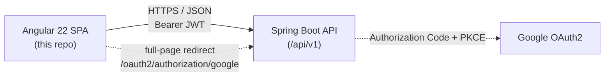
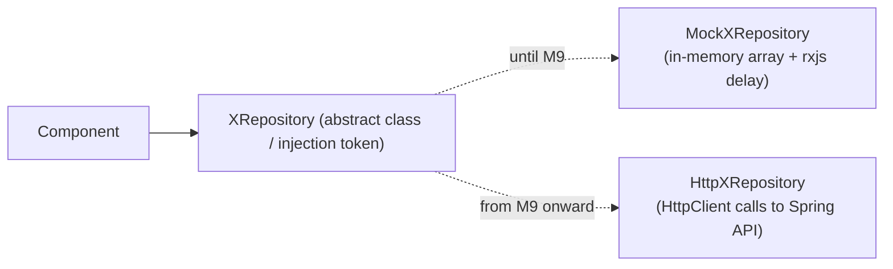

# Family Budget — Frontend Architecture

Status: draft v0.6 · 2026-10-07
Companion doc: [PLAN.md](../../.docs/PLAN.md) (workspace `.docs/`) (roadmap, phases, open decisions)
Backend, domain rules, API and security: [backend ARCHITECTURE.md][backend-arch]

[backend-arch]: https://github.com/omarkelovUA/budget-backend/blob/main/docs/ARCHITECTURE.md

## 1. Purpose and scope

Family Budget lets a household track money together while each member keeps some of it
private: every account, category, transaction and budget is either **private** (only its
owner sees it) or **shared** (every member of the user's family sees it).

This document covers the Angular SPA only. The system-wide design — domain model and its
rules, REST API conventions, error types, authentication and authorization — lives in the
[backend ARCHITECTURE.md][backend-arch] and is only referenced here.

## 2. System context



- Single SPA, no server-side rendering requirement for v1.
- Talks only to the backend's REST API; it never talks to Google directly (the OAuth2 flow
  runs entirely on the backend, see §4.4).

## 3. Client data model

### 3.1 Types

`src/app/model/types.ts` holds the shared interfaces (`IUser`, `IFamily`, `IAccount`,
`IAccountRef`, `ICategory`, `Transaction`, `IBudget`, …). They follow the API's wire
format rather than the database shape:

- Ids are UUID strings issued by the backend.
- Sharing is a `visibility: 'private' | 'shared'` field, not the backend's
  `ownerType`/`ownerId`.
- Enum values are lower-case (`'income'`, `'payment'`, `'admin'`, …).

The exact differences between these types and the JSON (ISO dates, ids instead of embedded
objects on create, the transaction page wrapper) are listed in the backend doc §3.3 and
handled inside the `Http*Repository` classes (§4.3).

### 3.2 Visibility rules the UI relies on

The backend enforces these; the UI only has to present them correctly:

- A user belongs to at most one family in v1. Without a family, only private data exists
  and creating anything `shared` fails (`no-family`).
- Accounts have one owner, who sets each family member to hidden / visible / shared
  (`IAccount.access` is the current user's level; `grants` only reaches the owner). The
  account form shows that per-member editor, and only the owner can edit, close or delete
  an account. The account list groups accounts into *mine / shared with me / visible to
  me*. Transaction pickers offer only open accounts the user may record on
  (`canRecordOn`), and the transaction list shows delete only when `editable`.
- Closing an account moves its balance to another open, same-currency account the user
  can record on, then archives it. The close dialog only offers such targets.
- **Settings** (header → *Settings*, `SettingsDialog`; cached in `SettingsState`, loaded
  when the session starts): the UI **language**, the **theme** (light, dark or device),
  the **used currencies** and the
  **default currency**, which must be one of them. The backend picks the language and
  default currency from the browser's region at sign-up. New accounts start in the
  default currency, and the account form offers the used currencies; any other code can
  still be typed in.
- **Family transfers** (`FamilyTransfers` on the accounts page): send money from an
  own account to a family member, *collect* what's waiting into an own account in the
  same currency, or *take back* what wasn't collected yet. The money waits in a
  transient account, which never shows up in account lists or pickers. On the
  dashboard, money a user sent that hasn't been collected stays in their totals
  (*у дорозі*).
- Family invitations are addressed to an email and only usable once that email is
  verified, i.e. the user signed in with Google. Otherwise the family page offers Google
  sign-in instead of the list. Accepting while already in a family moves the user out of
  it, so the page asks for confirmation first. A family holds at most 10 people, pending
  invitations included.
- A category's or budget's visibility is fixed at creation, and so is a category's
  income/expense type — edit forms don't offer to change them.
- A transaction shows the accounts it touches as `IAccountRef` (no `balance`): a family
  member can see a transfer from someone's private account without seeing that account.
- Transactions are create/delete only; deleting can fail with `transaction-not-editable`
  when the caller can't access all of its accounts.
- Month totals come back per currency and are never summed across currencies.

## 4. Frontend architecture (Angular)

### 4.1 Stack

- Angular 22, standalone components only (no NgModules).
- **Signals** for all local/component state; `signal()`, `computed()`, `effect()`,
  `linkedSignal()` where appropriate.
- All forms use **Signal Forms** (`@angular/forms/signals`; migrated in M4).
- `rxResource` for request-backed state; plain `resource()` where a request is driven by a
  signal instead of an `Observable`.
- No NgRx / global store library. Domain state lives in per-domain **signal-based
  services** (`providedIn: 'root'`), each exposing readonly signals + methods — the same
  shape a lightweight SignalStore would have, without the extra dependency. Revisit only
  if cross-feature state coordination actually gets painful.

### 4.2 Folder structure

```
src/app/
  core/                     # app-wide singletons, no UI
    auth/                   # AuthState, route guards; data/ = AuthRepository + http impl
    http/                   # authInterceptor, ProblemDetail → message mapping (problem.ts)
    i18n/                   # languages, LanguageService, translation loader
    config/                 # API base path (api.ts)
  shared/                   # dumb, reusable, no domain knowledge
    ui/                     # visibility-badge (categories/budgets), access-badge (accounts),
                            # icon-picker (icon lists in icons.ts; SVGs in public/assets)
  model/                    # shared TypeScript interfaces/types (types.ts)
  features/
    accounts/
      data/                 # AccountRepository contract + HttpAccountRepository
      account-list/ account-form/
    categories/
    transactions/
    budgets/
    family/                 # family creation, email invitations, member list
    auth/                   # login and register pages
    dashboard/              # aggregated overview (balances, month summary)
  app.routes.ts             # lazy-loaded per feature
src/i18n/                   # en.json, uk.json: one translation file per language
src/test-providers.ts       # providers every spec gets (translations, settings stub)
```

### 4.3 Mock-first data layer (the "dumb hardcoded service" strategy)

Goal: build and visually/behaviorally validate every screen before the backend exists,
then swap in real HTTP without touching components.



- Each domain defines a repository **contract** (abstract class, so it's a valid DI
  token) returning `Observable<T>`.
- Components/pages inject the **abstract contract**, never a concrete implementation —
  swapping is a one-line change in `app.config.ts` providers (or per-environment
  provider), not a component rewrite.
- While mocks existed they deliberately covered edge cases (zero balances, multiple
  currencies, a shared + a private account, an over-budget category) so UI states
  weren't discovered late.

As of M9 the mocks are deleted: every contract has only its `Http*Repository`
implementation, mapping DTOs (UUID ids, ISO date strings, ids instead of embedded
objects on create) and turning backend `ProblemDetail` types into user-facing messages
(`core/http/problem.ts`).

### 4.4 Auth on the frontend

The server side of the flow (token issuing, refresh-token rotation, Google login) is in
the backend doc §6. On the client:

- `core/auth/AuthState` holds the current user and the access token in signals —
  memory only, never localStorage. The user's `familyId` is looked up via
  `GET /families/current` right after a session starts.
- `provideAppInitializer` calls `restoreSession()` before the first route guard runs:
  a `POST /auth/refresh` with the httpOnly cookie, so a reload keeps the user logged in.
- `authInterceptor` adds the bearer token to `/api` calls (not `/api/v1/auth/*`). On a
  401 it refreshes once — concurrent 401s share one refresh, since each refresh rotates
  the cookie — and retries; if refreshing fails it clears the session and goes to
  `/login`.
- Google login is a full-page navigation to `/oauth2/authorization/google`. The backend
  redirects back to `/auth/callback`; by then the startup refresh has already restored
  the session, so `oauthCallbackGuard` just routes to `/dashboard` (or to
  `/login?error=oauth` on failure).
- Route guards (`authGuard`, `guestGuard`) are functional `canActivate` guards on the
  auth signal.

### 4.5 Error handling

The backend returns every error as a `ProblemDetail` with a stable `type` URI (list in
the backend doc §5.4). `core/http/problem.ts` maps the type slug to a user-facing message,
so components switch on the problem type, never on the bare HTTP status. The message is
`errors.<slug>` from the translation files, in the language active when the error
happens; the backend's English `detail` is never shown.

### 4.6 Internationalization

- **Transloco** (`@jsverse/transloco`) switches the language at runtime, without a
  reload. `@jsverse/transloco-locale` formats money, numbers and dates for the active
  language (`en` → `en-GB`, `uk` → `uk-UA`) through its `translocoCurrency`,
  `translocoDecimal` and `translocoDate` pipes. Don't use Angular's `date`/`number` pipes
  or `Intl` with a fixed locale.
- **Translations** live in `src/i18n/{lang}.json`, bundled as lazy chunks (only the
  active language is downloaded). Keys are namespaced by feature: `common.*`, `nav.*`,
  `auth.*`, `accounts.*`, `categories.*`, `transactions.*`, `budgets.*`, `dashboard.*`,
  `family.*`, `familyTransfers.*`, `settings.*`, `errors.*`. Templates use
  `*transloco="let t"`. Text built in TypeScript stays a key until the template
  translates it, so it follows a language switch. A spec checks that every language has
  the same keys and that every known problem type has a message.
- **Which language is active:** the account's setting, once signed in (`SettingsState`
  applies it when the session starts and after saving settings); before that, the
  language last used on this device (`localStorage`), then the browser's
  (`navigator.languages`; a Ukrainian region counts as Ukrainian), then English.
  `LanguageService` loads the file before switching, and the app initializer waits for
  it, so the UI never shows bare keys. It also sets `<html lang>`.
- **Adding a language:** add `src/i18n/<code>.json` with every key, add the code to
  `LANGUAGES` (name in that language, formatting locale) and to the loader's file map
  in `core/i18n`, and add it to the backend's `SupportedLanguage`.
- **Specs** get both languages synchronously through `src/test-providers.ts` (the unit-test
  builder's `providersFile`), in Ukrainian unless a spec switches.

### 4.7 Theme and colours

- **Tokens:** every colour comes from `src/styles/theme.css` (`--color-*`; plan and later
  phases in the workspace's `.docs/theme.md`). Values are OKLCH, derived from two inputs,
  `--primary-h` and `--primary-c`, so a user-chosen primary colour (phase 2) only sets
  those two. Component CSS never uses raw colours; `colors.spec.ts` fails on any hex,
  rgb or named colour outside `theme.css`.
- **Light and dark:** each token is `light-dark(light, dark)`. `ThemeService`
  (`core/theme`) sets `color-scheme` on `<html>` to `light`, `dark` or `light dark`
  (device). Precedence is the same as for the language: the account's `theme` setting,
  then the device's last choice (`localStorage`), then `system`.
- **Icons** are drawn by `app-icon` as a CSS mask filled with `currentColor`, so they
  follow the theme. Don't use `` for them.
- **Contrast:** text tokens pass WCAG AA on the surfaces they're used on, in both themes;
  keep it that way when adding tokens.

### 4.8 Local dev

`ng serve` proxies `/api`, `/oauth2` and `/login/oauth2` to the backend
(`src/proxy.conf.json`), so the browser sees one origin — no CORS, and the refresh
cookie (`Path=/api/v1/auth`, `SameSite=Strict`) behaves as in production. Running the
backend locally is described in the backend repo's `docs/LOCAL-DEV.md`.

## 5. Key decisions & why

System-wide decisions (two repos, sharing model, auth design, backend stack) are in the
backend doc §8.

| Decision | Choice | Why |
|---|---|---|
| Frontend state | Per-domain signal services, no NgRx | Matches Angular's current direction (signals as the primitive); avoids a global-store dependency the app's complexity doesn't need yet. |
| Mock-to-real swap | Abstract repository contract + DI token/provider swap | Let UI work start before the backend existed without a later rewrite; only the provider wiring changed. |
| Access token storage | Memory only, refresh via httpOnly cookie | Limits XSS blast radius; a reload recovers the session through `/auth/refresh`. |

## 6. Open questions

Tracked with owners/status in [PLAN.md §Open decisions](../../.docs/PLAN.md#open-decisions) —
not repeated here to avoid the two docs drifting out of sync.
